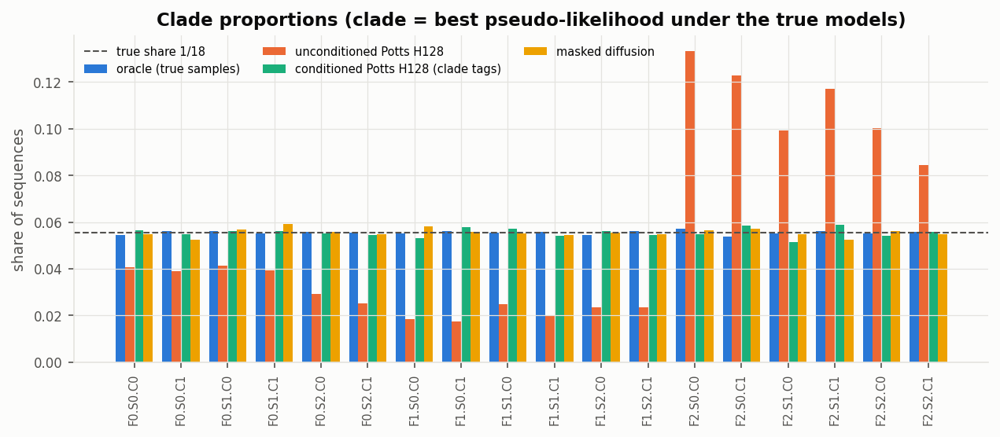
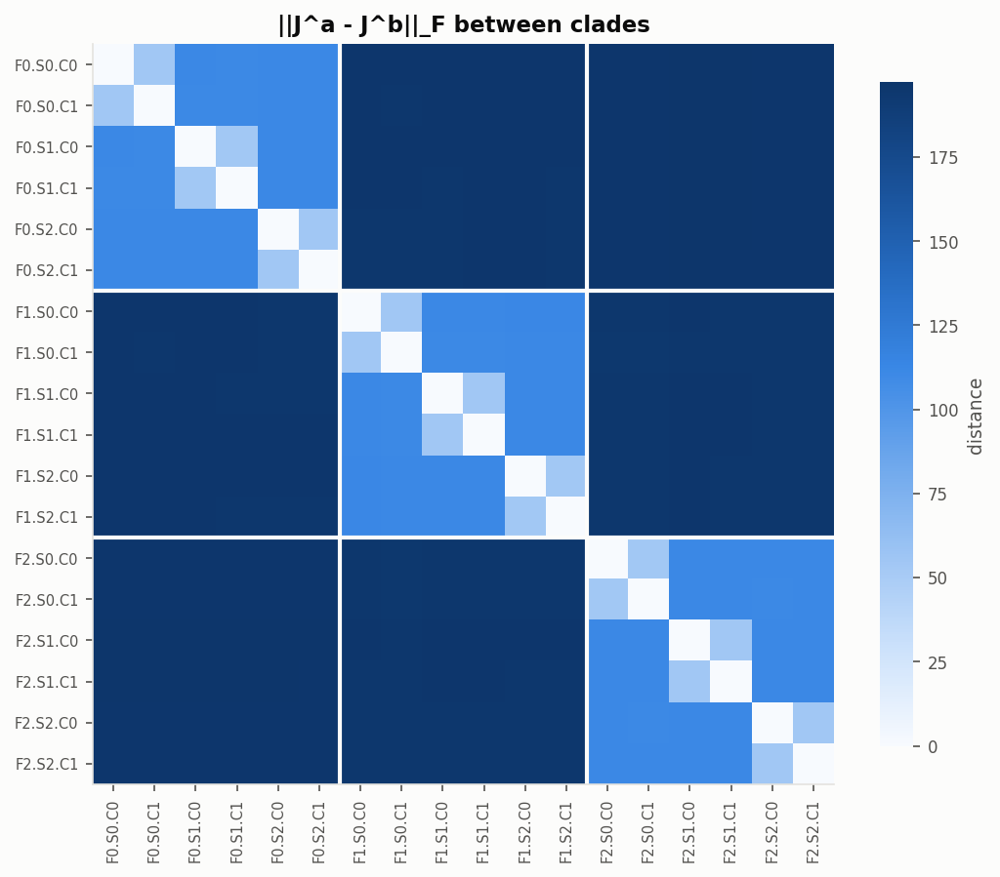
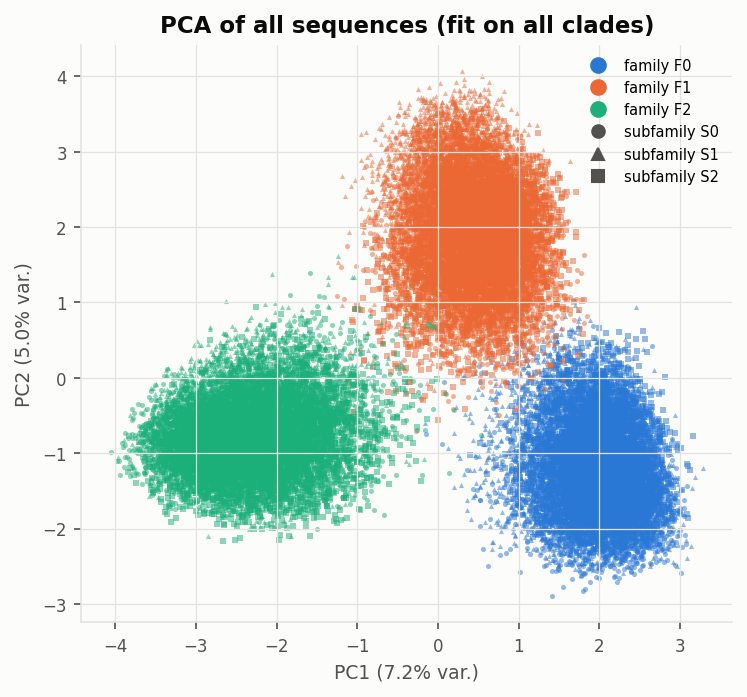

# Learning hierarchical Potts models

**Can a generative model learn a family of protein-like sequences with a known hierarchy, at every level of that hierarchy?**

Real protein alignments never tell you the true distribution, so you cannot check whether a generative model got it right. This project builds a benchmark where you can. It uses a tree of [Potts models](https://en.wikipedia.org/wiki/Potts_model) (3 families → 9 subfamilies → 18 clades) whose parameters are known exactly, samples 180,000 sequences from it, and trains two kinds of generative models on those sequences:

1. **Factored attention**: a transformer whose output *is* a Potts model, with couplings J<sub>ij</sub> = Σ<sub>h</sub> softmax(Q<sup>h</sup>K<sup>h⊤</sup>)<sub>ij</sub> V<sup>h</sup>. It is trained by pseudo-likelihood, either unconditioned or conditioned on hierarchical family/subfamily/clade tags.
2. **Masked (absorbing-state) diffusion**: a transformer that learns to un-mask residues, trained on a bound of the full likelihood (MDLM). It is unconditioned and never sees a label.

Both are judged against the ground truth on single-site and pair statistics, family and clade proportions, distances in sequence and PCA space, memorisation, and the conditional probabilities themselves.

📄 **Short paper:** [`docs/paper/paper.pdf`](docs/paper/paper.pdf) (4 pages, results and insights)
📘 **Full document:** [`docs/modelization.pdf`](docs/modelization.pdf) (theory and derivations from scratch, implementation, tests, all results)

---

## Main findings

| | uses labels | family shares (true: 33/33/33 %) | pooled r<sub>C</sub> (true samples: 0.994) | per-clade r<sub>C</sub> (true samples: 0.828) |
|---|---|---|---|---|
| Potts / factored attention, unconditioned | no | 22 / 13 / 66 % | 0.895 | 0.562 |
| Potts / factored attention, hierarchical tags | **yes** | 33 / 33 / 33 % | – | 0.751 |
| **Masked diffusion** | **no** | **33 / 33 / 33 %** | **0.992** | **0.764** |

- **The ground truth is hierarchical as designed.** Coupling distances between clades depend only on the depth of their common ancestor and match a closed-form prediction to within 0.5 %.
- **Pseudo-likelihood finds the structure but not the global weights.**
  - The factored-attention Potts model recovers every true contact (precision 1.00).
  - Its couplings are closest to the *ancestral* model of the tree.
  - It generates the families in wrong proportions. The cause: the family weights are the small residual of a near-cancellation between energy and entropy, which only the partition function Z sees, and pseudo-likelihood never evaluates Z.
- **Hierarchical tags fix the proportions.** A clade tag generates its clade (18/18). The tag-specific information is carried mostly by the fields h, not the couplings J.
- **Masked diffusion gets every level right without labels.**
  - Families and clades come out in the right proportions.
  - Its pooled statistics are essentially those of true samples.
  - Per clade, it matches or beats the Potts model that is *given* the clade tag.
  - Its conditionals P(s<sub>i</sub> | s<sub>−i</sub>) are as close to the truth as those of the tag-conditioned model.
  - The cost: no interpretable J, and 10–100× more training time.
- **No memorisation**: no model reproduces training sequences; nearest-neighbour distances match those of held-out data.

<p align="center">
  <br>
  <em>Share of generated sequences in each of the 18 clades. Dashed line: true share 1/18.</em>
</p>

<p align="center">
  
  <br>
  <em>Left: coupling distances between the 18 ground-truth clades (the nested blocks are the tree). Right: PCA of all sequences, coloured by family.</em>
</p>

### Work in progress: dynamical regimes of diffusion
Following Biroli, Bonnaire, de Bortoli & Mézard, *Dynamical regimes of diffusion models* (Nat. Commun. 2024), we transposed the **speciation** and **collapse** times from Gaussian noise to masking:
- **Speciation:** generation commits top-down, deciding the family after ≈2 revealed residues, the subfamily after ≈5 and the clade after ≈8.
- **Collapse:** the exact optimum of the training loss would collapse onto a training sequence after ≈6 residues. A parameter-free theory predicts this to within 0.2 residues.
- **Memorisation:** the trained network never collapses onto training sequences.

These are first results. The theory and the first measurements are in Part IV of [`docs/modelization.pdf`](docs/modelization.pdf). The refined estimates quoted here are in [`docs/notes/speciation_refined.pdf`](docs/notes/speciation_refined.pdf): they use exact class posteriors and correct for the classifier error, which is why the clade value is lower than the 16 given in Part IV.

---

## Quick start

```bash
git clone https://github.com/yk985/hierarchical-_Potts_models_learning.git
cd hierarchical-_Potts_models_learning
pip install -r requirements.txt          # numpy, scipy, matplotlib, torch, pytest
python -m pytest                         # 84 tests, ~5 min; outcome plots go to figures/tests/
```

The repository already contains the ground-truth models, the data splits, the trained models and all evaluation outputs, so you can inspect results without re-running anything. To reproduce from scratch, run the pipeline in order:

```bash
# Part I: ground truth
python scripts/s01_build_ground_truth.py          # tree of 31 Potts models + hierarchy check
python scripts/s02_sample_ground_truth.py         # Gibbs sampling, 18 clades x 2000 sequences
python scripts/s03_analyze_ground_truth.py        # PCA, frequencies, correlations, reference metrics
python scripts/s04_make_dataset.py                # 10k sequences per clade, train/val/test 80/10/10 (GPU)

# Part II: factored attention (Potts) models
python scripts/s05_train_factored_attention.py --config configs/fa_unconditional.json   # or fa_conditional.json, *_H256.json
python scripts/s06_evaluate_model.py           --config configs/fa_unconditional.json
python scripts/s07_compare_to_tree.py          --config configs/fa_unconditional.json   # learned J vs every node of the tree
python scripts/s08_mode_mixing.py              --config configs/fa_unconditional.json   # family weights: model or sampler?

# Part III: masked diffusion
python scripts/s09_train_diffusion.py    --config configs/md_unconditional.json        # --resume continues from last.pt
python scripts/s10_evaluate_diffusion.py --config configs/md_unconditional.json
python scripts/s11_compare_models.py                                                    # all models, same metrics
python scripts/s12_time_dependence.py    --config configs/md_unconditional.json

# Part IV (in progress): speciation and collapse
python scripts/s13_dynamical_regimes.py  --config configs/md_unconditional.json
python scripts/s14_regimes_refined.py    --config configs/md_unconditional.json
```

Every parameter lives in `configs/`. Timings on one RTX 2060:
- Gibbs sampling: about 30 s per clade.
- Factored-attention runs: 2–23 min each.
- Diffusion training: about 4 h (150 epochs, mixed precision).
- Part IV analyses: 40–90 min each.

## Repository layout

| path | content |
|---|---|
| `src/psg/` | the library: Potts model and gauge (`potts`), the tree (`hierarchy`), Gibbs samplers (CPU `sampling`, GPU `torch_sampling`), statistics and PCA (`stats`), datasets (`data`), factored attention (`models/factored_attention`, `training`), masked diffusion (`models/masked_diffusion`, `diffusion_training`), metrics (`evaluation`, `distances`), speciation and collapse tools (`regimes`), plotting (`plots`) |
| `scripts/` | pipeline steps `s01`–`s14`, one script per step |
| `tests/` | one test file per build step, on small systems with hand-checkable or exactly enumerable answers |
| `configs/` | ground truth, model and training configurations |
| `data/ground_truth_potts/` | the 31 Potts models of the tree (zero-sum gauge), the contact map, `tree.json` |
| `data/sequences/`, `data/splits/` | sampled sequences (FASTA per clade) and the train / val / test splits (144k / 18k / 18k) |
| `models/<run>/` | trained models (`model.pt`), training history and logs |
| `sampling/<run>/` | generated sequences (FASTA) |
| `evaluations/<run>/` | metrics as JSON |
| `figures/` | ground-truth figures, per-run figures, model comparison, and the outcome plots of every test |
| `docs/` | `modelization.tex/.pdf` (full document), `paper/` (short paper), `notes/` (detailed notes on Part IV) |

## How the project was built
Each step was built and tested before the next:
- every function has a test on a case small enough to check by hand or by exact enumeration, for example a Gibbs sampler against the enumerated distribution, or a diffusion sampler with an exact denoiser;
- each step's outcome plots are saved under `figures/tests/`;
- the theory and the model (inputs, outputs, loss) were written up before any long training run.

## Requirements
Python ≥ 3.10, numpy, scipy, matplotlib, PyTorch (CUDA recommended for steps 4 onwards), pytest. Developed with Python 3.12, PyTorch 2.6 (CUDA 12.4), numpy 2.0.

## Author
Youssef Kabbaj, MSc Applied Physics, EPFL.
